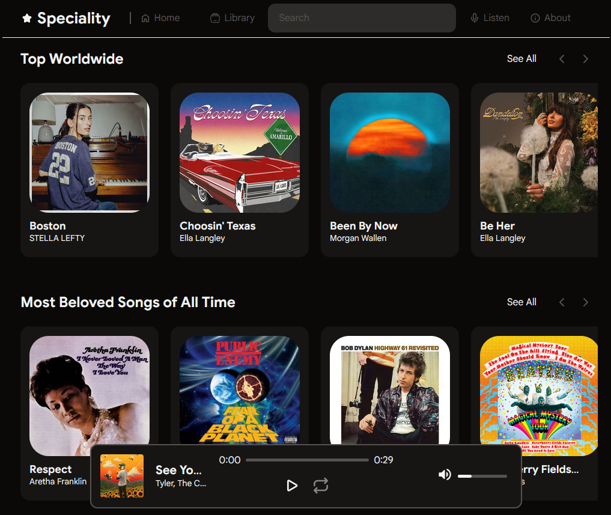

# Speciality

A music player built with React and Vite, using Deezer's free API for music discovery
and AudD for audio recognition.


	
## Features

- Search for songs, albums and artists in the Deezer library
- Listen to 30-second previews of songs
- Identify songs playing around you with the Listen button (AudD)
- Build your own library of artist and album shelves

## Technologies

- Node.js and npm
- React, React Router, Vite
- JavaScript, HTML and CSS
- dnd-kit (drag-and-drop reordering)
- Deezer API
- AudD API

## Requirements

- [Node.js](https://nodejs.org) 22.12 or newer
- [Git](https://git-scm.com)
- An [AudD](https://audd.io) API token. It is only needed for the Listen feature,
  and the rest of the app works without it.

## Installation

### 1. Clone the repository

```bash
git clone https://github.com/koikawa0/Speciality.git
```

### 2. Go into the project folder

```bash
cd Speciality
```

### 3. Install dependencies

```bash
npm install
```

### 4. Create your .env file

```bash
cp .env.example .env
```

On Windows Command Prompt, use `copy .env.example .env` instead.

### 5. Add your AudD token

Open `.env` and replace the placeholder with your token:

```
AUDD_API_TOKEN=your_audd_token_here
```

### 6. Start the development server

```bash
npm run dev
```

### 7. Open the app

Open the local URL shown in your terminal.

## Notes and limitations

- Designed to run locally. The Deezer proxy and the Listen feature only work
  with `npm run dev`.
- Playback is **30-second previews** only.

## Disclaimer

Not affiliated with Deezer or AudD. Music data and previews belong to their respective owners.

## Author

[@koikawa0](https://github.com/koikawa0)